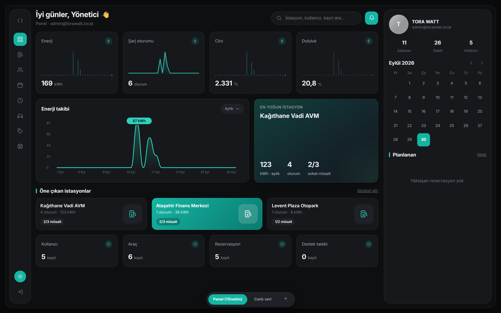

# TORA WATT Yönetim Paneli

Şarj ağını web üzerinden yöneten panel. Backend **Go**, arayüz **React +
[React Cupertino UI](https://react-cupertino-ui.pro/)** (MIT). İkisi tek bir
binary'de: arayüz derlenip Go'nun içine gömülüyor, dağıtımda yanına hiçbir şey
koymak gerekmiyor.



## Hızlı başlangıç

**PowerShell** (Windows'un varsayılanı). Bu sürümde `&&` bir komut ayracı
değil, o yüzden satırlar ayrı ayrı yazılıyor:

```powershell
# 1. Arayüzü derle (çıktı doğrudan backend'in gömdüğü klasöre yazılır)
cd admin\web
npm install
npm run build

# 2. Binary'yi üret
cd ..\backend
go build -o toraadmin.exe ./cmd/toraadmin

# 3. Çalıştır - veritabanı vermezsen örnek veriyle açılır
$env:ADMIN_PASSWORD = "güçlü-bir-parola"
.\toraadmin.exe
```

**Git Bash / Linux / macOS**:

```bash
cd admin/web && npm install && npm run build
cd ../backend && go build -o toraadmin ./cmd/toraadmin
ADMIN_PASSWORD="güçlü-bir-parola" ./toraadmin
```

Panel `http://localhost:8090` adresinde. Giriş: `admin@torawatt.local` ve
verdiğin parola.

## Gerçek veriye bağlamak

`DATABASE_URL` verildiği anda panel örnek veriyi bırakıp mobil uygulamanın
veritabanını okur; alt çubuktaki **"Demo veri"** rozeti **"Canlı veri"**
olur.

```powershell
$env:DATABASE_URL = "postgresql://..."
$env:ADMIN_PASSWORD = "..."
.\toraadmin.exe
```

```bash
DATABASE_URL="postgresql://..." ADMIN_PASSWORD="..." ./toraadmin
```

Şema değişikliği **gerekmiyor**: panel mobil uygulamanın mevcut tablolarını
(`User`, `Station`, `Connector`, `Vehicle`, `Reservation`,
`ChargingHistoryEntry`, `Campaign`, `SupportRequest`) okuyor ve yazıyor. Yeni
tablo eklenmedi, migration çalıştırmıyor.

## Ayarlar

| Değişken | Varsayılan | Açıklama |
| --- | --- | --- |
| `ADMIN_PASSWORD` | — | Zorunlu (ya da `ADMIN_PASSWORD_HASH`). Düz parola açılışta bcrypt'lenir. |
| `ADMIN_PASSWORD_HASH` | — | Üretimde tercih edilen yol: parolayı ortamda düz tutmamak için. |
| `ADMIN_EMAIL` | `admin@torawatt.local` | Giriş e-postası. |
| `DATABASE_URL` | boş | Boşsa örnek veri. |
| `ADMIN_ADDR` | `:8090` | Dinlenen adres. |
| `ADMIN_JWT_SECRET` | rastgele | Verilmezse her yeniden başlatmada oturumlar düşer. |
| `ADMIN_SESSION_HOURS` | `12` | Oturum süresi. |
| `ADMIN_DEV_PROXY` | boş | Arayüzü Vite'tan servis eder (aşağıya bak). |

## Geliştirme

İki süreç: Go API'yi, Vite arayüzü verir ve anlık yeniler.

```powershell
# 1. terminal
cd admin\backend
$env:ADMIN_PASSWORD = "dev"
go run ./cmd/toraadmin

# 2. terminal
cd admin\web
npm run dev                     # http://localhost:5180
```

Vite `/api` isteklerini 8090'a geçiriyor, yani arayüzde çalışırken Go'yu
yeniden derlemek gerekmiyor.

## Neler yönetiliyor

| Bölüm | Yapılabilenler |
| --- | --- |
| **Panel** | Enerji, oturum, ciro, doluluk; dönem grafiği (7/30/90 gün), en yoğun istasyonlar, yaklaşan rezervasyonlar |
| **İstasyonlar** | Listeleme, arama, soketleri açıp durum değiştirme (müsait/dolu/arızalı/çevrimdışı), istasyon silme |
| **Kullanıcılar** | Arama, araç/oturum/enerji özeti, hesap silme |
| **Rezervasyonlar** | Duruma göre süzme, durum ilerletme (onayla / geldi / tamamla / iptal) |
| **Şarj oturumları** | Geçmiş kayıtlar, enerji ve ciro toplamı |
| **Araçlar** | Salt okunur liste (kullanıcının kendi kaydı; teknik değerleri yönetim değiştirmez) |
| **Kampanyalar** | Ekleme, düzenleme, yayından kaldırma, silme |
| **Destek** | Talep listesi (şemada durum alanı yok, salt okunur) |

## Tasarım

Yerleşim referans tasarımla aynı: sol simge rayı, dört ölçü kartı, geniş
grafik + vurgulu kart, üç kart, sağda profil/takvim/planlananlar, altta sekme
çubuğu. Değişen tek şey renkler — turuncu vurgu yerine markanın turkuazı
(`#0FB5A3`), tokenlar mobil uygulamanın `src/theme/colors.ts` dosyasıyla aynı
değerleri taşıyor. Açık/koyu tema sol alttaki düğmeyle değişiyor.

Grafikler el yazımı SVG (`web/src/components/charts.tsx`): üç sade grafik için
bir grafik kütüphanesinin varsayılanlarıyla boğuşmak yerine tasarımı birebir
veren ~150 satır.

## Güvenlik notları

- Oturum bileti **HttpOnly** çerezde; sayfadaki betikler okuyamıyor.
- Yanlış e-postada da bcrypt karşılaştırması çalışıyor — cevap süresi
  "bu e-posta kayıtlı mı" sorusunu ele vermesin diye.
- JWT'de algoritma sabitlenmiş (`HS256`), `alg: none` kabul edilmiyor.
- Beklenmeyen hataların metni istemciye **gönderilmiyor** (şema/sorgu
  sızdırabilir), sunucu loguna tam haliyle düşüyor.
- CSP, `X-Frame-Options: DENY`, `nosniff` başlıkları her yanıtta.

Panel dış dünyaya açılacaksa TLS'in arkasına koyulmalı: çerez `Secure`
bayrağını yalnızca TLS varken alıyor.

## Bilinen sınırlar

- Tek yönetici hesabı var ve ortam değişkeninden geliyor. Birden fazla
  yönetici için `AdminUser` tablosu ve bir migration gerekir; mobil uygulamayla
  ortak veritabanına izinsiz tablo eklememek için bilerek yapılmadı.
- Destek taleplerinde "çözüldü" işareti yok; şemada alan bulunmuyor.
- Arayüz kütüphanesinin bazı paketleri derin içe aktarma kullanıyor ve
  Rollup bunu çözemiyor; `web/vite.config.ts` içinde takma ad var, kütüphane
  düzelttiğinde kaldırılabilir.
